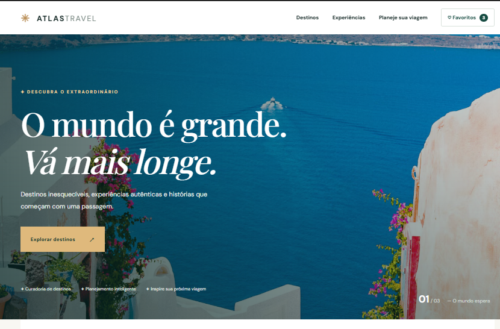

# ✈️ Atlas Travel — Explore o Mundo

Atlas Travel é uma plataforma demonstrativa de turismo desenvolvida com HTML, CSS e JavaScript.

O projeto apresenta destinos turísticos ao redor do mundo, permitindo explorar lugares, filtrar destinos, salvar favoritos e simular o planejamento de uma viagem.

## 🌐 Projeto online

O link da versão publicada será adicionado após a publicação no GitHub Pages.

## 🖼️ Preview

## ✨ Funcionalidades

- Catálogo com 12 destinos turísticos
- Busca de destinos por nome ou país
- Filtros por continente e orçamento
- Ordenação dos destinos
- Janelas interativas com detalhes de cada destino
- Sistema de favoritos com contador
- Planejador de viagens com estimativa de custos
- Personalização por duração, quantidade de viajantes e estilo de viagem
- Navegação entre as seções
- Menu adaptado para dispositivos móveis
- Layout responsivo para desktop, tablet e celular

## 🛠️ Tecnologias utilizadas

- HTML5
- CSS3
- JavaScript
- Git
- GitHub
- GitHub Pages (para publicação)

## 📱 Responsividade

O Atlas Travel foi desenvolvido com uma interface adaptável a diferentes tamanhos de tela, incluindo computadores, tablets e smartphones.

## 💡 O que pratiquei neste projeto

- Estruturação de páginas com HTML semântico
- Criação de layouts responsivos com CSS
- Manipulação do DOM com JavaScript
- Eventos e interações do usuário
- Filtragem e ordenação de dados
- Implementação de favoritos
- Cálculos dinâmicos com JavaScript
- Criação de janelas modais
- Desenvolvimento de formulários interativos
- Versionamento com Git

## 📌 Observação

O Atlas Travel é um projeto fictício desenvolvido para fins de estudo e portfólio. Os valores apresentados são estimativas ilustrativas e não representam ofertas comerciais ou reservas reais.